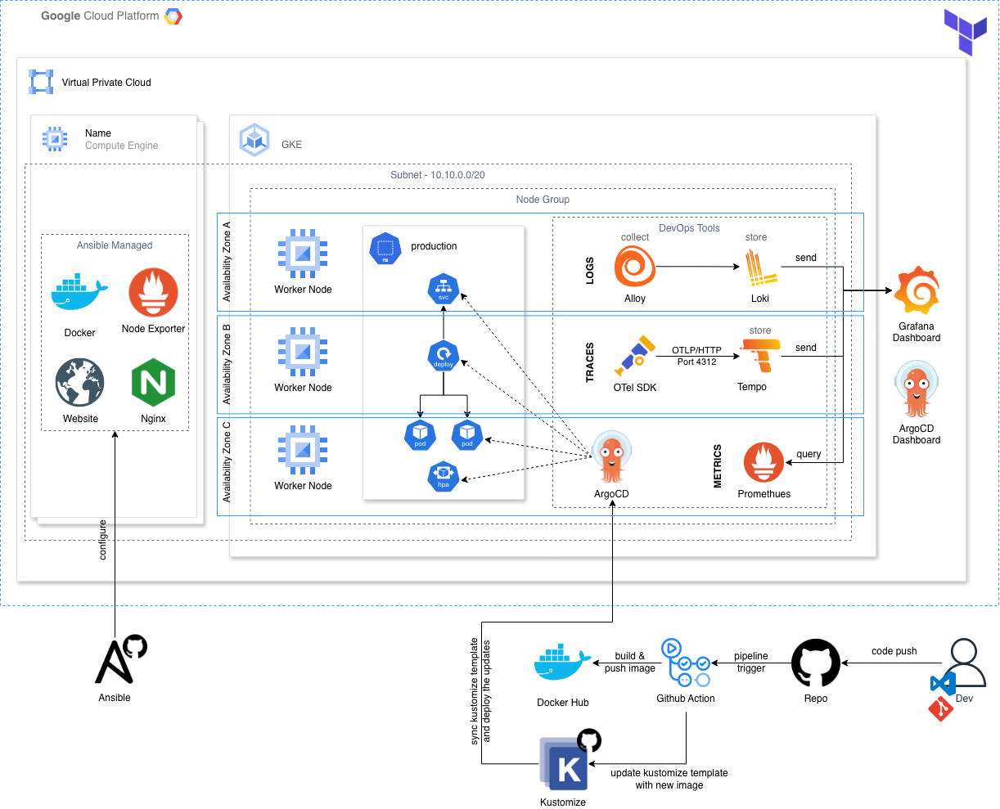

# 7Solutions — DevOps Technical Assessment

End-to-end infrastructure and deployment automation for a Go HTTP API on **Google Kubernetes Engine (GKE)**. The project covers infrastructure provisioning, containerization, Kubernetes configuration, GitOps, CI/CD, observability, and configuration management of a separate Ubuntu VM.

> **Environment status:** The assessment environment was deployed and tested, then decommissioned to avoid ongoing GCP charges. This repository preserves the configurations and deployment workflow; it is not a live hosted environment.

## Architecture



*Logical architecture. Kubernetes workloads are not pinned to the specific worker nodes or zones shown in the diagram.*

| Layer | Implementation |
| --- | --- |
| Cloud infrastructure | Terraform, Google Cloud VPC, regional GKE, Cloud Router/NAT, Compute Engine VM |
| Application | Go HTTP service, multi-stage Docker build, Docker Hub image |
| Orchestration | GKE, Kustomize, Deployment, ClusterIP Service, HPA, PDB |
| GitOps | Argo CD automated sync from `master` |
| CI/CD | GitHub Actions: test, vet, build, push, update Kustomize image tag |
| Observability | Prometheus/Grafana (metrics), Alloy/Loki (logs), OpenTelemetry/Tempo (traces) |
| VM configuration | Ansible roles for Ubuntu packages, Docker, NGINX, and Node Exporter |

### Infrastructure design

- **Region:** `asia-southeast1` (Singapore); regional GKE cluster `hello-api-gke` with private worker nodes.
- **Networking:** One custom VPC, `hello-api-vpc`, with subnet `hello-api-subnet` (`10.10.0.0/20`), Pod secondary range `10.20.0.0/16`, and Service secondary range `10.30.0.0/16`. Cloud NAT provides outbound access for private nodes.
- **Application:** `hello-api` runs in the `production` namespace behind an internal Kubernetes `ClusterIP` Service (`80 → 8080`). HPA targets 60% CPU utilization across 2–6 replicas.
- **Monitoring:** Prometheus, Grafana, Loki, Alloy, and Tempo are Kubernetes workloads in the `monitoring` namespace; Argo CD runs in `argocd`.
- **Standalone VM:** `ansible-vm` shares the GCP subnet, uses an external IP for restricted SSH access, and runs an NGINX Docker container plus a systemd-managed Node Exporter.

## Repository structure

```text
.
├── .github/workflows/cicd.yaml       # Build, test, push, and GitOps tag update
├── Dockerfile                         # Multi-stage Go container build
├── main.go                            # Go API with OpenTelemetry tracing
├── go.mod / go.sum
├── terraform/                        # GCP network, GKE, IAM, and Ubuntu VM
├── k8s/
│   ├── base/                          # Deployment, Service, ServiceAccount
│   └── overlays/production/           # Image tag, resources, HPA, PDB
├── argocd/                            # App and monitoring Helm Applications
├── ansible/
│   ├── inventory/hosts.ini            # VM connection configuration
│   ├── site.yaml                      # Main role-based playbook
│   └── roles/                          # system, docker, nginx, node_exporter
└── docs/architecture.png              # Infrastructure diagram
```

## CI/CD and GitOps

1. An application-code push to `master` triggers `.github/workflows/cicd.yaml` (or the workflow can be started manually).
2. GitHub Actions runs `go test ./...` and `go vet ./...`, then builds an AMD64 image and pushes it to `chickohhno/hello-api:<git-commit-sha>` on Docker Hub.
3. The workflow updates `images[].newTag` in `k8s/overlays/production/kustomization.yaml` and commits the change to `master`.
4. Argo CD tracks that Git path and synchronizes the rendered manifests to GKE. The worker nodes pull the image from Docker Hub.

**Required GitHub Actions secrets:** `DOCKERHUB_USERNAME` and `DOCKERHUB_TOKEN`. The workflow only triggers automatically for its configured application/build-file paths; changing Terraform or Ansible files does not deploy infrastructure.

## Deployment

### Prerequisites

- A GCP project with billing enabled and permissions to create GKE, networking, IAM, and Compute Engine resources.
- Terraform `>= 1.6`, Google Cloud CLI, `kubectl` with GKE authentication support, Ansible, SSH, and the Docker-compatible Ansible collection.
- Application development/build tools when needed: Go `1.25` and Docker Buildx.
- An SSH key at `~/.ssh/ansible_gce.pub`, used by the Terraform VM configuration.

### 1. Provision GCP resources

```bash
# Authenticate your local Terraform/GCP tooling
gcloud auth login
gcloud auth application-default login
gcloud config set project YOUR_GCP_PROJECT_ID

# Create the VM SSH key if it does not already exist
ssh-keygen -t ed25519 -f ~/.ssh/ansible_gce
```

Create a local `terraform/terraform.tfvars` (excluded from Git):

```hcl
projec_id = "YOUR_GCP_PROJECT_ID"
admin_cidr = "YOUR_PUBLIC_IPV4/32"
region     = "asia-southeast1"
```

> `projec_id` retains the variable name used in this repository's Terraform configuration. `admin_cidr` restricts the GKE control-plane endpoint and VM SSH firewall rule to the specified source range.

```bash
cd terraform
terraform init
terraform fmt -check -recursive
terraform validate
terraform plan
terraform apply
terraform output
cd ..
```

### 2. Configure GKE and bootstrap Argo CD

```bash
gcloud container clusters get-credentials hello-api-gke \
  --region asia-southeast1 --project YOUR_GCP_PROJECT_ID

kubectl config current-context
kubectl get nodes

kubectl create namespace argocd
kubectl apply -n argocd --server-side \
  -f https://raw.githubusercontent.com/argoproj/argo-cd/stable/manifests/install.yaml
kubectl rollout status deployment/argocd-server -n argocd --timeout=300s

kubectl apply -f argocd/application.yaml
kubectl apply -f argocd/monitoring.yaml \
  -f argocd/loki.yaml -f argocd/alloy.yaml -f argocd/tempo.yaml
kubectl get applications -n argocd
```

The Argo CD Application files declare chart versions and enable automated sync. For long-lived environments, pin the Argo CD installation manifest to a tested release rather than `stable`.

### 3. Configure the Ubuntu VM with Ansible

Terraform outputs the VM's external IP. Update the `ansible_host` value in `ansible/inventory/hosts.ini` to match the **new** VM; the committed IP refers to the original, decommissioned environment.

```bash
terraform -chdir=terraform output -raw ansible_vm_public_ip

cd ansible
ansible-galaxy collection install community.docker
ansible -i inventory/hosts.ini ubuntu -m ping
ansible-playbook -i inventory/hosts.ini site.yaml --syntax-check
ansible-playbook -i inventory/hosts.ini site.yaml
ansible-playbook -i inventory/hosts.ini site.yaml  # idempotency check
cd ..
```

The playbook applies the `system`, `docker`, `nginx`, and `node_exporter` roles. NGINX is published on `127.0.0.1:8080` on the VM; Node Exporter listens on `127.0.0.1:9100` under a non-login systemd account. The VM exporter is **not** automatically scraped by the GKE Prometheus instance.

## Verification

**Kubernetes application** (two terminals):

```bash
kubectl get applications -n argocd
kubectl get pods,hpa,pdb,svc -n production
kubectl rollout status deployment/hello-api -n production
kubectl port-forward -n production svc/hello-api 8080:80
```

```bash
curl 'http://127.0.0.1:8080/?name=GKE'
# Expected: Hello GKE
```

**Observability:**

```bash
kubectl get pods,svc -n monitoring
kubectl port-forward -n monitoring svc/monitoring-grafana 3000:80
```

Open `http://localhost:3000` for Grafana. Prometheus collects cluster metrics; Alloy forwards `production` Pod logs to Loki; the Go OpenTelemetry SDK sends HTTP traces to Tempo at `tempo.monitoring.svc.cluster.local:4318`. See [monitoring setup and validation](argocd/monitoring.md) for datasource checks and test queries. A deployed collector or datasource alone does not establish that data ingestion succeeded.

**Standalone VM** (from the `ansible/` directory):

```bash
ansible -i inventory/hosts.ini ubuntu -b -m command -a 'docker ps'
ansible -i inventory/hosts.ini ubuntu -m command -a 'curl -fsS http://127.0.0.1:8080/'
ansible -i inventory/hosts.ini ubuntu -b -m command -a 'systemctl is-active node_exporter'
ansible -i inventory/hosts.ini ubuntu -m command -a 'curl -fsS http://127.0.0.1:9100/metrics'
```

## Teardown

Review all resources and any data to retain before teardown. Monitoring PVCs may create persistent GCP disks independently of Terraform. Delete cluster-managed storage while the cluster is still running, where possible, then verify remaining cloud resources after destruction.

```bash
# Confirm the intended GKE context first
kubectl config current-context
kubectl get pvc -A
kubectl get pv

# If retiring this assessment environment and discarding monitoring data:
kubectl delete applications.argoproj.io monitoring loki alloy tempo -n argocd --ignore-not-found
kubectl delete namespace monitoring
kubectl get pv  # Confirm the monitoring PVs are gone

# After required in-cluster storage cleanup, from repo root:
cd terraform
terraform plan -destroy -out=destroy.tfplan
terraform show destroy.tfplan
terraform apply destroy.tfplan
terraform state list
cd ..

# Check for resources outside Terraform state
gcloud compute disks list --project YOUR_GCP_PROJECT_ID
gcloud compute forwarding-rules list --project YOUR_GCP_PROJECT_ID
gcloud compute addresses list --project YOUR_GCP_PROJECT_ID
```

The assessment's GCP environment was subsequently destroyed, including residual monitoring persistent disks. Reprovisioning incurs cloud charges.

## Design considerations

- **Security:** Private GKE nodes; authorized control-plane access; non-root container user, read-only root filesystem, dropped capabilities, and disabled ServiceAccount-token automount; restricted VM SSH; loopback-only VM demo services.
- **Reliability:** Rolling updates, health probes, HPA, PodDisruptionBudget, managed GKE node pool, and systemd/ Docker restart policies.
- **Scope:** A technical-assessment deployment, not a production HA platform. Observability backends use single-instance configurations, the application is not exposed through a public ingress, and the VM's Node Exporter is local-only.

For more detail, see [Argo CD deployment](argocd/argocd.md) and [observability configuration](argocd/monitoring.md).
